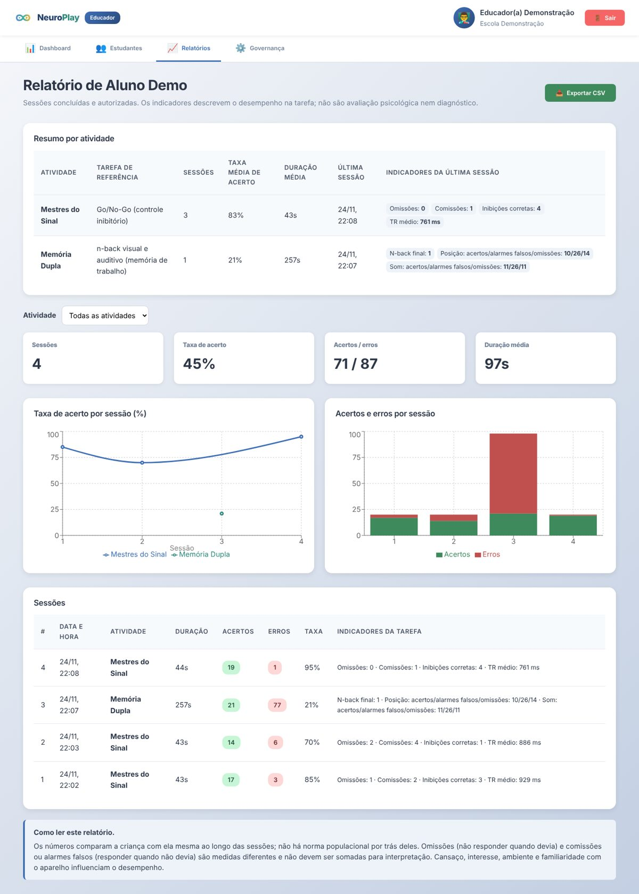
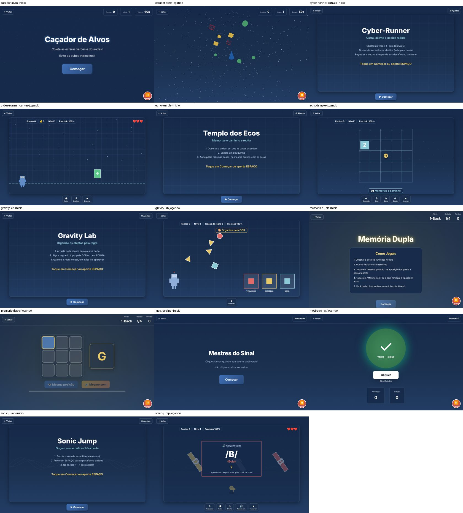

# Avaliação final de design

Data: 24/11/2026 · Escopo: as 7 atividades, o painel do aluno e o painel do educador, em desktop (1280×800) e celular (390×844). Objetivo: deixar o produto pronto para análise com uma psicóloga.

## Critérios

1. **Público TEA/TDAH:** estímulo visual calmo, nada piscando ou pulsando sem necessidade, fim previsível, saída sempre visível, erro sem tom punitivo.
2. **Harmonia:** as sete atividades com a mesma aparência (fundo, fonte, placar, títulos e botões).
3. **Usabilidade:** nada coberto ou cortado, alvos de toque grandes, resposta sem precisar rolar a página.
4. **Leitura profissional:** o relatório mostra as medidas próprias de cada tarefa, sem linguagem clínica indevida.

## O que foi encontrado e corrigido

| Área | Problema | Correção |
|---|---|---|
| Harmonia | 4 jogos em fundo preto com neon (ciano, vermelho, azul), 3 jogos em azul, cada um com uma fonte e uma borda | Tema único (`shared/theme/`): mesmo fundo azul-marinho, mesma fonte, mesmo placar em "fichas" e mesma tela de abertura e de fim |
| Sensorial | Brilho neon em títulos e objetos; sobreposição pulsando no Sonic Jump; notas musicais flutuando; fundo girando na Memória Dupla; aviso vermelho com ⚠️ ao trocar a regra no Gravity Lab | Brilho removido; sobreposição fixa; fundos parados; troca de regra anunciada num cartão calmo ("A regra mudou!") |
| Tom | "GAME OVER" em vermelho; "Treinamento Cognitivo Avançado"; "Missão", "Match" | "Atividade concluída" / "Corrida concluída" com o resumo; subtítulos descrevem a tarefa; botões em português ("Mesma posição", "Mesmo som") |
| Interrupções | Janelas `alert()` do navegador no fim do Mestres do Sinal, na troca de nível da Memória Dupla e ao salvar ajustes | Mensagens dentro da própria tela |
| Layout | O botão "Voltar" cobria o placar dos 4 jogos em canvas | Palco com espaço reservado para "Voltar" e controles; placar começa depois do botão |
| Layout | Memória Dupla: botões de resposta abaixo da dobra (a criança teria de rolar durante uma tarefa cronometrada) | Grade, letra e botões cabem juntos na tela |
| Layout | Gravity Lab: título "GRAVITY LAB" fantasma atrás da regra; dica coberta pelo "Encerrar"; 3ª caixa cortada | Fundo limpo, regra numa faixa fixa, caixas alinhadas dentro do canvas |
| Layout | Sonic Jump: contagem sobreposta ao texto no cartão do som | Cartão com uma informação por linha |
| Bug | Cyber-Runner: cliques nos desafios não convertiam a posição para a escala do canvas | Coordenadas convertidas |
| Medida | Memória Dupla não contava omissões (repetição não marcada) e aceitava duas respostas iguais ao mesmo estímulo | Omissões contadas; uma resposta de cada tipo por estímulo |
| Relatório | Só pontos, acertos e erros; linha ligando jogos diferentes; gráfico de "nível" sem significado; nomes técnicos (`mestres-sinal`) | Ver seção abaixo |

## Relatório do educador

- **Resumo por atividade:** tarefa de referência, sessões, taxa média de acerto, duração média e indicadores da última sessão.
- **Indicadores da tarefa** (gravados pela API em cada sessão):

  | Atividade | Indicadores |
  |---|---|
  | Mestres do Sinal (Go/No-Go) | omissões, comissões, inibições corretas, tempo de reação médio |
  | Memória Dupla (n-back) | nível N final; por posição e por som: acertos, alarmes falsos e omissões |
  | Templo dos Ecos | maior sequência lembrada, nível |
  | Gravity Lab | trocas de regra, experimentos |
  | Caçador de Alvos | colisões, tempo de reação médio |
  | Cyber-Runner, Sonic Jump | nível, vidas restantes |

- **Evolução:** taxa de acerto por sessão, com uma linha por atividade, e acertos/erros por sessão; filtro por atividade.
- **Exportação CSV** com data e hora, tarefa, taxa e indicadores.
- **Nota de leitura:** comparação da criança com ela mesma, sem norma populacional; omissões e comissões não devem ser somadas; fatores de contexto.

## Resultado

- 34 telas (17 × 2 tamanhos): 0 erros de JavaScript, 0 elementos cobertos, 0 textos cortados, 0 rolagem lateral.
- As 7 atividades jogadas no navegador, todas salvando a sessão com os indicadores.
- Frontend: 83 testes; backend: 9 testes (inclui a gravação e a limpeza dos indicadores).

## Pontos para discutir com a psicóloga

1. **Validade das medidas:** o Go/No-Go segue o paradigma clássico (75% Go). Os demais jogos são adaptações lúdicas; seus números servem para acompanhar a própria criança, não para comparação com normas.
2. **Tempo de reação:** é medido no navegador e varia com o aparelho (tela de toque, mouse). Comparações devem usar o mesmo aparelho.
3. **Sonic Jump e Caçador de Alvos** têm a base científica mais fraca (ver [`../pesquisa/ANALISE_JOGOS_EVIDENCIAS.md`](../pesquisa/ANALISE_JOGOS_EVIDENCIAS.md)); a análise sugere substituí-los por Jogo das Emoções e Peixinhos (Flanker).
4. **Duração e frequência das sessões**, e quais indicadores a profissional considera úteis no dia a dia da escola ou clínica.
5. **Linguagem das telas e do relatório**, para confirmar que nada sugere diagnóstico ou promessa terapêutica.
